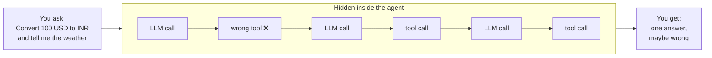
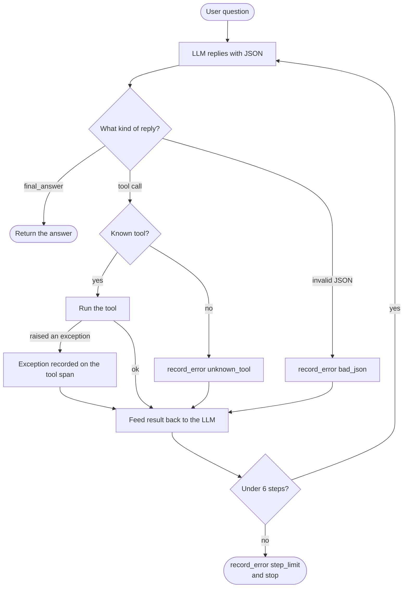
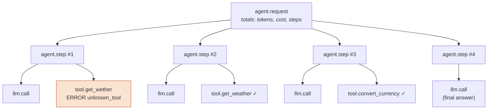
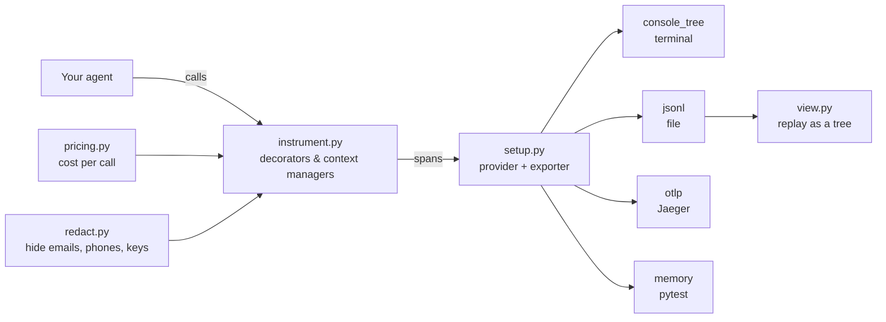
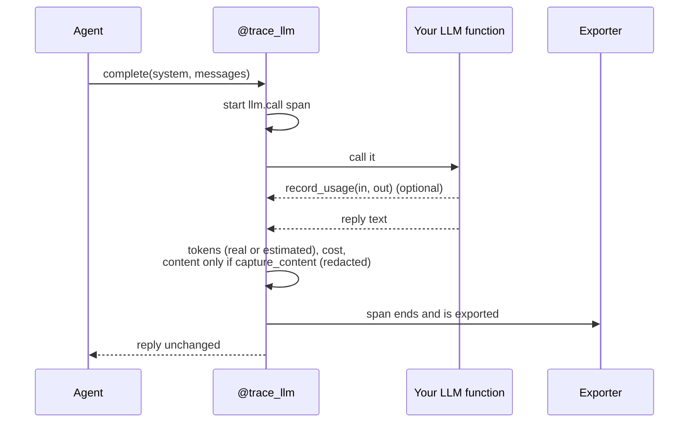

# agent-tracer

**See every step your AI agent takes.**

agent-tracer is a small Python library that records each LLM call, tool call and error your agent
makes as [OpenTelemetry](https://opentelemetry.io/) traces, so you can understand a failed run
and replay it later.


```
agent.request "mini_agent"                   28ms  in 614 / out 78 tok  $0.000423
├─ agent.step #1                              9ms
│  ├─ llm.call  model=example-small-model     2ms  in 89 / out 15 (est)  $0.000067
│  └─ tool.get_wether                         0ms  ERROR unknown_tool
├─ agent.step #2                              4ms
│  ├─ llm.call  model=example-small-model     0ms  in 131 / out 15 (est)  $0.000088
│  └─ tool.get_weather                        0ms  ok
├─ agent.step #3                              4ms
│  ├─ llm.call  model=example-small-model     0ms  in 173 / out 26 (est)  $0.000125
│  └─ tool.convert_currency                   0ms  ok
└─ agent.step #4                              2ms
   └─ llm.call  model=example-small-model     0ms  in 221 / out 22 (est)  $0.000143
```

---

## Contents

- [Quick start](#quick-start)
- [The problem](#the-problem)
- [Key ideas](#key-ideas)
- [How it works](#how-it-works)
- [Trace your own agent](#trace-your-own-agent)
- [All commands](#all-commands)
- [Expected output](#expected-output)
- [Design decisions](#design-decisions)
- [Project layout](#project-layout)
- [Exercises](#exercises)
- [Interview talking points](#interview-talking-points)

---

## Quick start

Requires **Python 3.10+**.

<table>
<tr><th>Windows (PowerShell)</th><th>Mac / Linux</th></tr>
<tr><td>

```powershell
git clone https://github.com/Arun-2010/agent-trace.git
cd agent-trace
python -m venv .venv
.venv\Scripts\activate
pip install -e ".[dev]"
python demo.py
```

</td><td>

```bash
git clone https://github.com/Arun-2010/agent-trace.git
cd agent-trace
python -m venv .venv
source .venv/bin/activate
pip install -e ".[dev]"
python demo.py
```

</td></tr>
</table>

> On Windows, use `py` instead if `python` isn't found (for example `py -m venv .venv`).

The demo uses a scripted LLM, so you don't need an API key. It prints the trace tree above and
saves it to `traces/demo.jsonl`.

---

## The problem

An agent run is a black box. You ask one question and get one answer, but behind it the model may
have made many calls. It might pick a tool, misspell it, retry, hit an error and try something else.



When the answer is wrong, all you see is the end result. You can't tell **which step failed**,
**how long each step took**, or **what it cost**. agent-tracer records every one of those hidden
steps.

---

## Key ideas

| Term | Meaning | Example |
|---|---|---|
| **Trace** | Everything that happened for one request, shaped as a tree | one run of the agent |
| **Span** | One timed step, with a start, an end, a parent and a status (`OK` / `ERROR` / `UNSET`) | `llm.call`, `tool.get_weather` |
| **Attribute** | A key/value fact attached to a span | `gen_ai.usage.input_tokens = 89` |

**Why OpenTelemetry?** It's the vendor-neutral standard for tracing. The same spans can go to a
local file, Jaeger, Grafana Tempo, Honeycomb, Arize Phoenix or Datadog without changing the
agent's code. Token attributes use OpenTelemetry's `gen_ai.*` naming conventions.

---

## How it works

### 1. The example agent loop

`examples/mini_agent.py` is a tiny tool-calling agent. The LLM replies with JSON: either
`{"tool": ..., "arguments": ...}` or `{"final_answer": ...}`.



Each pass through the loop becomes one `agent.step` span.

### 2. The span tree for one request



### 3. Architecture



### 4. The life of one LLM call



If anything raises, the span records the exception, is marked `ERROR`, and the exception is
**re-raised unchanged**. Tracing never changes what your program does.

---

## Trace your own agent

```python
from agent_tracer import setup_tracing, trace_request, agent_step, trace_llm, trace_tool, record_usage

setup_tracing("console_tree")            # or "jsonl", "otlp", "memory"

@trace_tool
def lookup_order(order_id: str) -> dict: ...

@trace_llm(model="example-large-model")
def ask_llm(system: str, messages: list[dict]) -> str:
    reply = my_client.chat(system, messages)
    record_usage(reply.input_tokens, reply.output_tokens)   # optional: real counts beat estimates
    return reply.text

with trace_request("support_bot", user_message=question):
    for n in range(1, 6):
        with agent_step(n):
            ...  # call ask_llm(...), then lookup_order(...)
```

| API | What it records |
|---|---|
| `setup_tracing(exporter)` | Turns tracing on and picks where spans go |
| `with trace_request(name, user_message)` | Root `agent.request` span with total tokens, cost and steps |
| `with agent_step(n)` | One `agent.step` span per turn of the loop |
| `@trace_llm(model=...)` | `llm.call` span with model, tokens and cost |
| `@trace_tool` | `tool.<name>` span for each tool call |
| `record_usage(in, out)` | Replaces the token estimate with real counts |
| `record_error(kind, message)` | Marks the current span `ERROR` for problems that aren't exceptions |

---

## All commands

| Command | What it does |
|---|---|
| `pytest` | Runs the test suite |
| `python demo.py` | Runs the example agent, prints the tree, saves `traces/demo.jsonl` |
| `python -m agent_tracer.view traces/demo.jsonl` | Replays a saved trace (add `--trace-id ID` to pick one) |
| `python demo.py --capture-content` | Also records prompts, replies and arguments (redacted) |
| `python demo.py --otlp` | Sends the trace to Jaeger |
| `python demo.py --live "question"` | Uses real Claude via the Anthropic API |

### View in Jaeger

```bash
docker run --rm -p 16686:16686 -p 4318:4318 jaegertracing/all-in-one:latest
python demo.py --otlp
# open http://localhost:16686, choose service "agent-tracer", click "Find Traces"
```

### Live mode (real Claude calls)

```powershell
# Windows (PowerShell)
pip install -e ".[anthropic]"
$env:ANTHROPIC_API_KEY = "sk-ant-..."
python demo.py --live "What's the weather in Pune?"
```

```bash
# Mac/Linux
pip install -e ".[anthropic]"
export ANTHROPIC_API_KEY="sk-ant-..."
python demo.py --live "What's the weather in Pune?"
```

In live mode the token counts come from the API response, so there's no `(est)` marker. No cost
is shown for `claude-sonnet-5-5` until you add its price to `agent_tracer/pricing.py`.

---

## Expected output

| Command | You should see |
|---|---|
| `python demo.py` | The tree at the top of this page, then `Answer: 100 USD is about 8,340 INR, ...` and the replay command |
| `python -m agent_tracer.view traces/demo.jsonl` | `trace <id>` followed by the same tree |
| `pytest` | `34 passed` |
| `python demo.py --otlp` | One trace in Jaeger with 12 spans: 1 request, 4 steps, 4 `llm.call`, 3 tools |
| `--otlp` without Jaeger running | A message with the `docker run` command to start it |
| `--live` without an API key | Instructions for setting `ANTHROPIC_API_KEY` on Windows and Mac/Linux |

**How to read the tree:**
- 4 steps means 4 turns of the agent loop.
- `ERROR unknown_tool` is the misspelled tool name in step 1.
- `(est)` means the tokens were estimated.
- `$` is the cost from the price table.

Timings will vary slightly from machine to machine.

---

## Design decisions

| Decision | Why |
|---|---|
| **No-op when off** | Without `setup_tracing()`, `get_tracer()` returns OpenTelemetry's no-op tracer. The decorators can stay in your code and cost almost nothing. |
| **Content off by default, plus redaction** | Prompts and tool arguments often hold personal data. They're recorded only with `capture_content=True`, and even then emails, phone numbers and API keys are replaced and text is cut to 2,000 characters. Error messages are always redacted. |
| **Estimated vs real tokens** | If the LLM function calls `record_usage()`, the real counts are used. Otherwise tokens are estimated as `ceil(chars / 4)` and flagged with `agent.tokens_estimated = True`, so an estimate never looks like a measurement. |
| **Never guess prices** | Costs come from an explicit table. An unknown model gets no cost attribute rather than a wrong one. The table ships with placeholder models only. |
| **Tracing never changes behaviour** | Exceptions are recorded, marked `ERROR` and re-raised unchanged. Return values pass straight through. |
| **Own provider instead of global** | OpenTelemetry lets you set the global tracer provider only once per process. Keeping the provider in a module variable lets every test, and every `setup_tracing()` call, start fresh. |

### Redaction example

```
before: I am bob@example.com, call +91 98765 43210, key sk-abc123def456
after:  I am [REDACTED_EMAIL], call [REDACTED_PHONE], key [REDACTED_KEY]
```

---

## Project layout

```
agent_tracer/
  __init__.py     public API exports
  setup.py        setup_tracing(), get_tracer(), exporters (console tree, jsonl, otlp, memory)
  instrument.py   trace_request(), agent_step(), @trace_llm, @trace_tool, record_usage(), record_error()
  pricing.py      price table + cost calculation
  redact.py       redact() for emails, phone numbers, API keys
  view.py         CLI + load_traces() + render_tree() (standard library only)
examples/
  mini_agent.py   tiny tool-calling agent used by the demo and tests
tests/            34 tests using the in-memory exporter
demo.py           runs the example agent with tracing on
```

---

## Exercises

1. **Retries:** wrap the LLM call in a retry loop and add an `llm.retry` span per attempt, with the
   attempt number and the error that caused the retry.
2. **Latency histogram:** add a `latency_ms` histogram with the OpenTelemetry metrics API and record
   the duration of every `llm.call` and `tool.*` span.
3. **Arize Phoenix:** run Phoenix locally and point `setup_tracing("otlp", otlp_endpoint=...)` at its
   OTLP endpoint. What shows up without any code change?
4. **LangChain / LangGraph:** trace a LangGraph agent by wrapping its nodes with `agent_step` and its
   tools with `@trace_tool`, then compare the result with LangChain's own callbacks.

---

## Interview talking points

- **Agents need tracing, not just logging.** Their steps are nested and depend on each other. A
  tree of spans shows "step 1 picked a misspelled tool, step 2 recovered" in a way flat logs can't.
- **Vendor-neutral by design.** The agent only talks to the OpenTelemetry API, so switching the
  backend (file, Jaeger, a SaaS) is a one-line config change.
- **Privacy first.** Content capture is opt-in, redacted and truncated. Traces leave the process,
  so they're treated as potentially public.
- **Honest numbers.** Estimated tokens are flagged as estimates, and unknown prices are left blank
  instead of guessed.
- **Zero-risk instrumentation.** Tracing re-raises every exception and never alters return values.
  With tracing off, it does nothing.
- **Testability.** An in-memory exporter plus a non-global provider turns every behaviour (tree
  shape, error status, totals, redaction) into a plain `pytest` assertion.
- **Errors that aren't exceptions.** Unknown tools, bad JSON and step limits are the most common
  agent failures. `record_error` makes them visible as `ERROR` spans with a `kind`.
